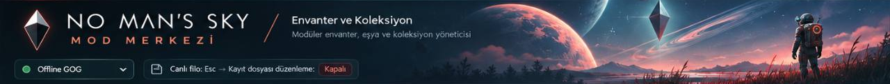

# NMS Menu

No Man’s Sky için Windows masaüstü kontrol paneli. **v0.9.0**; PySide6/Qt
arayüzü, entegre filo motoru, envanter ve koleksiyon araçları içerir.
Offline GOG kurulumu için geliştirilmiştir; Steam kaydını güncel kabul etmez.



**Arayüz dilleri:** Türkçe · English · Русский · Deutsch

## Özellikler

| Bölüm | İçerik |
| --- | --- |
| Canlı kontroller | Units, nanit, quicksilver; hız, jetpack, dayanıklılık, yaşam desteği ve kalkan ayarları |
| Canlı filo | Mevcut gemileri listeleme, onarım/şarj, envanter yuvalarını genişletme |
| Filo ve envanter | Gemi ekleme/kaldırma, donanım, normal kalkış otomatik şarjı, harici garaj |
| Silah koleksiyonu | Kaynak donanımla çok amaçlı alet ekleme/kaldırma |
| Katalog | 80 gemi profili/tohum seçeneği, 49 alet modeli/tohum seçeneği, 149 sabit teknoloji, 1100 eşya/madde |
| Envanter ve arşiv | Izgara, taşıma, yığın bölme/birleştirme, miktar, donanım setleri, seçili tarifler, yerleşik arşiv |
| Yedek ve geri alma | İşlem raporu, kaynak hash kontrolü, yedekleme ve tam kayıt geri alma |
| Ayarlar | Anında dil değişimi, kalıcı tercih, JSON çeviri dosyalarını yenileme |

Katalog sayıları oyundaki toplam tür sayıları değildir. Gemi/alet görünüm
seçenekleri, sınıf/istatistik veya ödül hakkının birebir kopyası anlamına gelmez.
Desteklenmeyen türler ve özellikler arayüzün rehber bölümünde açıklanır.

## Gereksinimler

- Windows x64, **Python 3.12** ve Python ile gelen Tkinter.
- Offline GOG oyun kurulumu. Canlı kontroller doğrulanmış **179666 GOG EXE
  hash’i** ile sınırlıdır; farklı sürümlerde yeniden doğrulama gerekir.
- İlk kurulum için internet. PySide6 ve kayıt codec’i kurulduktan sonra
  uygulama ağ bağlantısı gerektirmez.

## Kurulum

Depoyu oyun klasörünün içine `Menu` adıyla klonlayın:

```powershell
git clone https://github.com/EpsilonTh303/NMS-Menu.git Menu
cd Menu
.\setup.cmd
.\start.cmd
```

Kurulu klasör düzeni:

```text
oyun-klasörü/
├── Binaries/NMS.exe
└── Menu/
    ├── main.py
    ├── fleet.py
    ├── catalog.json / loadouts.json / preferences.json
    ├── codec/libNOM.io.cli.exe
    ├── locales/
    └── vendor/
```

`setup.cmd`, PySide6 bağımlılıklarını `vendor/` içine, resmî **libNOM.io CLI
0.14.2** Windows sürümünü `codec/` içine kurar. Codec’in dosya boyutu ve
SHA-256 değeri doğrulanır. Ayrı FleetManager veya SolarShipFix klasörü gerekmez.
İkili codec Git deposunda bulunmaz; kaynak, sürüm ve lisans bağlantıları
[codec/README.md](codec/README.md) içindedir.

Aktif kayıt konumu: `%APPDATA%/HelloGames/NMS/DefaultUser`.
Menü oyunu açmaz veya kapatmaz. Mevcut oyun başlatıcınızı kullanın;
CapsLockFix kullanılan kurulumlarda korumalı başlatıcı korunmalıdır.

## Kullanım

### Oyun kapalıyken kayıt düzenleme

1. Oyunda kaydedin ve oyunu tamamen kapatın.
2. Menüyü açın; ortak kayıt listesinin dolmasını bekleyin.
3. Doğru kayıt yuvasını ve hedefi seçin. Gemiyi ad/tohum/tür/yuva ile doğrulayın;
   prosedürel adın JSON’da boş olması normaldir.
4. Katalogda işlemleri sepete ekleyin veya filo bölümünden yeni plan hazırlayın.
5. Semantik fark raporunu inceleyip uygulayın.

Her istek yeni kaynak ve yeni işlem kullanır. Hazırlama aşaması canlı kayda
yazmaz. Uygulama, oyun kapalı ve kaynak hash’leri değişmemişse gerçekleşir.
Codec kodlama/çözme eşitliği doğrulanır; auto/manual kayıtlar bağımsız korunur.
Sepet değişirse eski inceleme geçersizleşir. Liste ve katalog oyun açıkken de
salt okunur görüntülenebilir.

### Oyun açıkken canlı kontroller

Kaydınızı yükleyip otomatik bağlantıyı bekleyin. Para ve karakter ayarları
**Canlı kontroller** bölümündedir. Canlı filo işlemleri için offline oturumda
**Esc duraklatma menüsünde kalın**; yeni planı ve raporu inceleyerek uygulayın.
Canlı filo sahiplik/model/tohum değiştirme veya teknoloji ekleme desteklemez.

Geçici karakter ayarları normal bağlantı kesme/kapanışta, değerler hâlâ
beklenen durumdaysa geri alınır. Para ve filo değişiklikleri otomatik geri
alınmaz; ilgili geri alma düğmeleri kullanılır. Oyun kaydederse kalıcı olabilir.
Ani panel kapanışında geçici ayarlar oyun yeniden başlatılana kadar kalabilir.

### Kapasite ve geri alma

- **12 aktif gemi ve 6 aktif alet** sınırı korunur. Sabit diziler genişletilmez.
- Harici garaj tam gemi kopyalarını saklar; aktif gemi sınırını artırmaz.
  Değiştirmede çıkan geminin kargo/teknolojisi yazımdan önce arşivlenir.
- Yerleşik arşiv 18 gemi/18 alet kullanır. Kargo korunur; yer yoksa işlem durur.
- Tam kayıt geri alma, seçilen işlemden önceki **bütün kayıt durumuna** döner.
  Daha sonraki ilerleme eski kayıtta bulunmaz; güncel durum ayrıca yedeklenir.
- Kalkış otomatik şarjı normal oyun teknolojisidir; anında sınırsız yakıt değildir.

Ayrıntılı motor komutları: [FLEET_ENGINE.md](FLEET_ENGINE.md).

## Dil sistemi

**Ayarlar → Arayüz dili** seçimi anında uygulanır ve
`runtime/ui-settings.json` dosyasında hatırlanır. Oyun dili değiştirilmez.

Her dil ayrı UTF-8 JSON dosyasıdır: `locales/tr.json`, `en.json`, `ru.json`,
`de.json`. Dil adı dosyanın `_meta.name` alanından okunur. Türkçe kaynak metin
sabit anahtardır; sağındaki değer ekranda gösterilir. Eksik çeviriler Türkçeye
döner. Mevcut dört dil 525 kaynak metin içerir; çeviriler Luna ajanlarıyla hazırlanmıştır.

Yeni dil ekleme:

```powershell
python -m nmsmenu.i18n add fr --name Français
```

Oluşan `locales/fr.json` dosyasındaki boş değerleri çevirip Ayarlar’dan
**Dil dosyalarını yenile** seçin. Kodda dil listesi düzenlemek gerekmez.

Yeni UI metinlerini `self.t("Metin")` / `t("Metin")` ile işaretleyin.
Ardından aşağıdaki komutlarla anahtarları birleştirip çevirileri doğrulayın:

```powershell
python -m nmsmenu.i18n sync
python -m nmsmenu.i18n check
```

`sync` mevcut çevirileri korur; yeni anahtarları diğer dillere boş değerle ekler.
`{v0}`, `{v1}` gibi değişkenler aynen korunmalıdır. Gemi/alet adları, tohumlar,
eşya ID’leri ve makine tarafından kullanılan JSON raporları çevrilmez.

## Başlatma seçenekleri

```powershell
python main.py --inventory  # Varsayılan envanter ekranı
python main.py --catalog    # Katalog
python main.py --fleet      # Canlı filo
python main.py --weapons    # Alet koleksiyonu
python main.py --settings   # Ayarlar / dil
python main.py --classic    # Önceki Türkçe Tk görünümü
```

## Geliştirme ve doğrulama

```powershell
python -m unittest discover -s tests
python -m nmsmenu.i18n check
python tools/install_codec.py --check
git diff --check
```

Sentetik testler oyun veya kişisel kayıt gerektirmez. `python -m unittest
test_fleet`, yerel tarihsel inceleme kopyaları varsa ek 13 testi çalıştırır;
bu özel kopyalar dağıtılmadığından temiz klonda ilgili sınıf atlanır.
Qt üzerinden canlı yazımın oyun içi uçtan uca doğrulaması bu sürüm için yapılmadı.

| Konum | Amaç |
| --- | --- |
| `nmsmenu/qt_ui.py`, `icons.py` | Qt sunumu ve yerel vektör ikonlar |
| `nmsmenu/ui.py`, `*_ui.py` | Korunan Tk denetleyicileri ve klasik görünüm |
| `fleet.py` | Entegre, yedekli işlem motoru |
| `nmsmenu/catalog_*`, `inventory.py`, `archives.py` | Katalog, sepet, envanter ve arşiv kuralları |
| `nmsmenu/live*.py`, `winmem.py` | Sürüm doğrulamalı canlı işlemler |
| `locales/`, `nmsmenu/i18n.py` | Çeviriler ve dil araçları |
| `codec/manifest.json`, `tools/install_codec.py` | Sabitlenmiş codec kurulumu |
| `tests/` | Sentetik testler |

`vendor/`, codec ikilisi, `runtime/`, `transactions/`, `garage/` ve kişisel
inceleme kayıtları Git dışında tutulur. Önceki kurulumdan taşınan garaj ve
işlem yedekleri aynı yerel verileri korur; eski Solar yedekleri yalnız o
kurulumda `runtime/legacy-solar/` altındadır. Depoyu klonlamak kişisel yedek getirmez.

## Diğer belgeler

- [Değişiklikler](CHANGELOG.md)
- [Motor kullanımı ve geri alma](FLEET_ENGINE.md)
- [Mimari](ARCHITECTURE.md) · [UI servis sınırları](UI_MIGRATION.md)
- [Katalog verilerinin kaynağı](data/README.md)
- [Yol haritası](ROADMAP.md) · [Araştırma notları](NMS-Research/README.md)

Araştırma belgelerindeki eski klasör adları tarihsel düzeni anlatabilir.
Uygulamanın güncel yolları bu README ve kod içindeki yollarla belirlenir.
